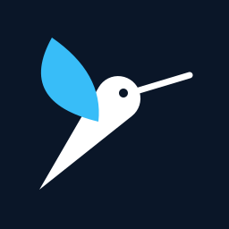

<p align="center"></p>

# Flutter & Dart Tools for Orca

An Orca plugin that brings the everyday Flutter/Android Studio workflow into Orca.

| Tab | What it does |
|---|---|
| **Run** | Run, hot reload, hot restart, stop, or **attach** to an app already running on the device. Device, debug/profile/release, entrypoint, flavor, `--dart-define` (KEY=VALUE per line), `--dart-define-from-file`, extra flags. Save named run configurations per package. |
| **Inspector** | Live widget tree with source locations (Enter / *Open source* jumps to the file), screenshots of phones and emulators, platform (iOS/Android/…) and brightness overrides, debug paint, performance overlay, select widget on device, slow animations, debug banner, text dumps of the widget/render/layer/semantics trees, and DevTools pages (inspector, performance, CPU, memory, network, logging). |
| **Build** | `flutter build apk / appbundle / ipa / ios / web / linux / macos / windows` in any mode. Before a release build it checks signing: a release build type signed with the debug key, a missing `android/key.properties` (common in fresh worktrees) or keystore, or no iOS development team. |
| **Tests** | Every test file, group and test in one tree with pass/fail/skip marks, rolled up per group and file. Run all, a file, a group, a single test, only the failed ones, or with coverage (percentage shown). Failure messages, stack traces and prints per test; integration tests run on the selected device. |
| **Checks** | Flutter SDK version, update check and `flutter upgrade` (with confirmation; FVM projects get `fvm use` guidance). analyze, format, `dart fix --apply`, build_runner, gen-l10n, clean, doctor. |
| **Packages** | Direct and dev dependencies with current and latest versions (`pub outdated`), update prompts, upgrade within constraints or to the latest major, add and remove packages, pub.dev and changelog links, and *Edit pubspec.yaml* in Orca's editor. |
| **Devices** | Connected devices (pick one as the run target), set an emulator's GPS location (Android emulators; iOS simulators on a Mac), launch emulators/simulators, create an Android emulator from an installed system image. |

A workspace without a project offers `flutter create` (app, package, plugin or module). New-file templates add StatelessWidget, StatefulWidget and animated widget files.

The panel follows the workspace focused in Orca and finds the Flutter app inside it, even in a monorepo (`apps/mobile`, …): breadth-first, six levels deep, apps with `lib/main.dart` first. Every command shows the exact command line it runs. Settings and sessions are kept per Orca workspace and package, so each worktree has its own configurations; monorepo packages are discovered automatically. Dart files get syntax highlighting.

## Install

In Orca: **Settings → Plugins**, search for *Flutter & Dart Tools*, and install it. Or from a terminal:

```sh
orca plugin install eveetc/flutter-dart-orca-plugin
```

It runs its own code (it starts `flutter` and `dart` for you), so Orca shows what it may access and asks you to approve it. Then open the **Flutter & Dart** panel in the right sidebar.

### Shortcuts

Android Studio-style defaults, rebindable in Orca's keyboard shortcuts. All commands are also in the command palette.

| Action | Shortcut |
|---|---|
| Run selected configuration | Ctrl/⌘ + Shift + F10 |
| Hot reload | Ctrl/⌘ + \ |
| Hot restart | Ctrl/⌘ + Shift + \ |
| Stop | Ctrl/⌘ + F2 |
| Repeat last build | Ctrl/⌘ + Shift + F9 |
| Format project | Ctrl/⌘ + Alt + L |

Orca's plugin API cannot open or embed Orca's built-in emulator view, so use that tab alongside this panel.

## Permissions

- **trusted-worker**: runs `flutter`, `dart` and `avdmanager` from your own SDK as your user.
- **workspace:read / workspace:write**: list workspaces; `workspace:write` is only used to open a widget's source file in Orca's editor.
- **storage:own / settings:own**: run configurations and SDK paths.

The signing check reads `build.gradle(.kts)`, `android/key.properties` and the Xcode project to see whether values are present. It never displays, stores or sends key or password values.

No shell is involved: arguments are passed to the SDK directly. The inspector only connects to the loopback VM service URL that `flutter run` reports.

## Layout

```
src/worker.ts          entry: requests, palette commands
src/service.ts         sessions, jobs, storage, validation
src/flutter-session.ts flutter run --machine protocol
src/inspector.ts       VM service client: widget tree, debug toggles
src/args.ts            pure run/build argument builders
src/projects.ts        package discovery, SDK resolution, path checks
src/release.ts         static Android/iOS signing checks
src/pub.ts             pub outdated parsing, add/remove/upgrade arguments
src/panel.tsx          panel shell; src/ui/*-tab.tsx one file per tab
```

## Requirements

Your own Flutter/Dart SDK (FVM, PATH, or a path in plugin settings) and, for emulators, the Android SDK.
The plugin never downloads SDKs or system images and never accepts SDK licenses for you.

## Development

```sh
npm install
npm run typecheck
npm test           # orca plugin test (unit, panel and worker tests)
npm run check      # validate + render panel scenarios
npm run screenshots  # store screenshots from fixture scenarios (minimize Orca first)
npm run art          # icon.png and cover.png from assets/icon.svg (needs Inkscape)
```

## License

MIT, see [LICENSE](LICENSE).

The Dart grammar in `syntaxes/dart.tmLanguage.json` comes from
[dart-lang/dart-syntax-highlight](https://github.com/dart-lang/dart-syntax-highlight) under the BSD 3-Clause license;
its notice is in [licenses/dart-grammar.txt](licenses/dart-grammar.txt).
Flutter, Dart and Android are trademarks of Google LLC; this project is not affiliated with or endorsed by Google.
The Flutter/Dart/Android SDKs are not bundled and are used under their own licenses.
